# Hi 👋, I'm Nipuna Gamage

### Software Engineering Graduate | Backend & Full-Stack Developer

Building practical software solutions with clean code and modern technologies.

[🌐 Portfolio](https://nipuna-gamage-portfolio.netlify.app/)

  

---

## 👨‍💻 About Me

- 🎓 Software Engineering graduate from the University of Westminster – IIT.
- 💼 Completed an industrial placement at the Ministry of Home Affairs, IT Department.
- 🔭 Developed an AI-driven traffic accident prediction and alert system.
- 🌱 Interested in Backend Development, Full-Stack Engineering, and Machine Learning.
- 🤝 Open to collaborating on web applications, backend systems, and AI projects.
- 💬 Ask me about Python, Java, PHP, Laravel, ReactJS, and SQL.
- 📫 Email: **nipunawgamage@gmail.com**

## 🛠️ Languages, Frameworks & Tools

### Programming Languages

### Web Development

### Database & Machine Learning

**Machine Learning:** XGBoost · LSTM · Data Preprocessing · Model Evaluation

### Development Tools

---

## 📊 GitHub Statistics

  

  
  

###
    
  

---

  

  

---

## 🤝 Connect With Me

  

⭐ Thanks for visiting my profile!

